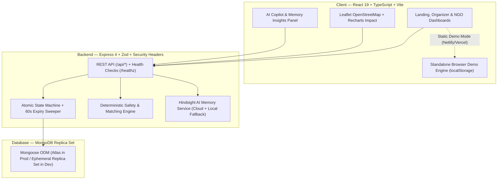

<div align="center">

# FoodBridge — Surplus Food Rescue Network

### *"Good Food. No Waste. Greater Impact."*

**Safety-first surplus food rescue connecting event organizers with verified nearby NGOs before holding windows expire.**

[](https://food-bridge-01.netlify.app/)
[](https://github.com/JayantOlhyan/food-bridge/actions/workflows/ci.yml)
[](./server/tests)
[](./LICENSE)
[](./package.json)
[](./client/package.json)

**[Launch Live Demo](https://food-bridge-01.netlify.app/)** · **[Technical Docs](./docs/ARCHITECTURE.md)** · **[Deployment Runbook](./DEPLOYMENT.md)** · **[Contributing](./CONTRIBUTING.md)** · **[3-Minute Demo Script](#3-minute-hackathon-demo-script)**

</div>

---

> **Core Innovation:**  
> *"FoodBridge doesn't simply find the nearest NGO. It prioritizes feasible, safety-eligible rescues before the collection window closes."*

---

## Table of Contents

1. [Live Demo](#live-demo)
2. [Why FoodBridge?](#why-foodbridge)
3. [Key Capabilities & Innovation](#key-capabilities--innovation)
4. [System Architecture](#system-architecture)
5. [Implemented (MVP) vs Planned / Simulated](#implemented-mvp-vs-planned--simulated)
6. [Matching Engine & Safety Filter Specification](#matching-engine--safety-filter-specification)
7. [API Reference](#api-reference)
8. [Project Structure](#project-structure)
9. [Tech Stack](#tech-stack)
10. [Quick Start & Local Setup](#quick-start--local-setup)
11. [Running Tests & Quality Checks](#running-tests--quality-checks)
12. [3-Minute Hackathon Demo Script](#3-minute-hackathon-demo-script)
13. [Deployment Guide](#deployment-guide)
14. [Team Techie Titans](#team-techie-titans)

---

## Live Demo

Try the full interactive application immediately — no login, backend, or setup required:

- **Live URL:** **https://food-bridge-01.netlify.app/**
- **Landing & Simulator:** Explore the worked 40-meal matching scenario and interactive impact simulator at `/`.
- **Interactive App (`/app`):** Switch roles in the top bar between **Organizer** and **7 seeded Delhi NGOs**, post surplus listings, inspect ranked matches on the Leaflet map, accept/collect/deliver pickups, and track verified meals & CO2e impact in real time.

---

## Why FoodBridge?

Large gatherings (weddings, banquet halls, temple bhandaras, gurdwara langars, concerts) generate significant edible surplus food, yet traditional recovery via phone calls, informal chat groups, or naive distance-based dispatch fails because:

1. **Holding limits expire quickly** — Hot-held or room-temperature food becomes unsafe within hours if dispatch stalls.
2. **The nearest NGO often lacks capacity** — Routing 40 meals to a shelter with 10 beds leaves 30 meals unrescued.
3. **City traffic invalidates raw distance** — An NGO 1 km away that arrives after the safe collection window is worse than an NGO 2 km away that arrives with margin to spare.

---

## Key Capabilities & Innovation

FoodBridge replaces ad-hoc dispatch with a **deterministic, safety-first matching engine**:

- **Safety Eligibility Filter:** Evaluates holding condition (`hot-held`, `refrigerated`, `room-temperature`, `packaged-sealed`) against maximum holding hours and minimum collection lead time. Unsafe or expired listings are blocked before any NGO sees them.
- **Feasibility Hard Filters:** Enforces NGO active status, operating hours, dietary compatibility (`veg` vs `non-veg`), road travel ETA (`haversineKm / avgSpeed + buffer`), and remaining capacity.
- **Capacity Tiering:** Strictly ranks **Full matches** (`remainingCapacity >= quantity`) above **Partial matches**, avoiding wasted split trips.
- **Multi-Factor Scoring (0–100):** Ranks feasible full matches using time margin (slack before safe deadline), travel distance, and capacity fit.
- **AI Memory Insights & Copilot:** Optional Hindsight-backed memory service (`server/services/hindsight.js`) surfaces past delivery reliability, transit delays, and operational preferences — with strict guardrails so AI never overrides deterministic safety or capacity rules, plus an automatic local memory bank fallback when offline.
- **Atomic State Machine:** Prevents double accepts (`POSTED → ACCEPTED → COLLECTED → DELIVERED`) via MongoDB transactions, auto-sweeps expired listings, and restores NGO capacity on cancellation or expiry.

---

## System Architecture



---

## Implemented (MVP) vs Planned / Simulated

| Component | Status | Implementation Details |
|---|---|---|
| **Safety Eligibility Filter** | **Implemented** | Deterministic check: hold hours by condition, min lead time, future prep check, safe deadline computation. |
| **Feasibility Matching Engine** | **Implemented** | Pure JS/TS module evaluating travel ETA, NGO hours, diet compatibility, capacity tiering, and multi-factor ranking. |
| **Organizer Web App** | **Implemented** | Smart listing creation with map pin drop, live eligibility report, ranked NGO cards with reasons, pickup tracking. |
| **NGO Web App** | **Implemented** | Urgency-sorted feed (`High` / `Medium` / `Low`), remaining capacity banner, 1-click accept/collect/deliver flow. |
| **Pickup Tracking & Handover** | **Implemented** | Timeline tracker (`POSTED → ACCEPTED → COLLECTED → DELIVERED`) with verified delivered meals & kg modal. |
| **Impact Dashboard** | **Implemented** | Confirmed delivered meals, kg rescued, deliveries count, estimated CO2e avoided (`kg * 2.5`), Recharts timeline. |
| **Interactive Map** | **Implemented** | Leaflet + OpenStreetMap tiles with Delhi coordinates, venue pins, color-coded NGO markers, and travel polylines. |
| **Standalone Browser Demo** | **Implemented** | 100% client-side demo engine (`client/src/demoEngine.ts`) with `localStorage` persistence and 1-click Reset Demo — powers [food-bridge-01.netlify.app](https://food-bridge-01.netlify.app/). |
| **AI Copilot & Memory Insights** | **Implemented** | Hindsight memory service (`server/services/hindsight.js`) with token-conservation caching, deduplication, and offline local memory bank fallback. |
| **Database & Concurrency** | **Implemented** | Express + MongoDB replica set (`mongodb-memory-server` in dev/test, Atlas in prod) with atomic `findOneAndUpdate` transactions. |
| **Automated Testing** | **Implemented** | **52 Vitest unit & integration tests across 8 suites** covering matching, API state machine, AI memory, health checks, security headers, and client `demoEngine`. |
| **Deployment & CI/CD** | **Implemented** | Multi-stage `Dockerfile`, MongoDB replica-set `docker-compose.yml`, `netlify.toml`, `vercel.json`, `render.yaml`, GitHub Actions CI/CD, `/healthz` readiness checks, and [`DEPLOYMENT.md`](./DEPLOYMENT.md). |
| **Authentication** | **Simulated** | Role switcher in topbar (`Organizer` & `NGO A`–`NGO G`). *Firebase Auth planned.* |
| **Notifications** | **Simulated** | In-app simulated alerts bell with polling. *Firebase Cloud Messaging (FCM) planned.* |
| **SMS / Push / Payment** | **Planned** | Out of scope for MVP; marked as planned in UI and docs. |

---

## Matching Engine & Safety Filter Specification

### 1. Safety Filter (`server/services/matching.js`)
Demo thresholds (labeled clearly in UI and code as illustrative demo values, not official FSSAI guidance):
- `maxHoldHours`: `hot-held`: **4h**, `refrigerated`: **8h**, `room-temperature`: **2h**, `packaged-sealed`: **6h**
- `minLeadMinutes`: **30 minutes**
- `safeDeadline` = `min(pickupWindowEnd, preparedAt + maxHoldHours[condition])`

**Marked `INELIGIBLE` (and never exposed to NGOs) if:**
- `safeDeadline <= now`
- `(safeDeadline - now) < minLeadMinutes`
- `quantityMeals <= 0`
- `preparedAt > now` (future preparation time)
- `pickupWindowStart >= pickupWindowEnd`

### 2. Feasibility Hard Filters
Every active NGO is evaluated against:
1. **Activity:** Dropped if `!ngo.active`.
2. **Operating Hours:** Dropped if estimated arrival time falls outside `availableFrom` – `availableTo`.
3. **Diet Compatibility:** Dropped if listing includes `non-veg` and `!ngo.acceptsNonVeg`.
4. **ETA Feasibility:** `travelMinutes = (haversineKm / avgSpeedKmh) * 60 + bufferMinutes`. Dropped if `now + travelMinutes > safeDeadline`.
5. **Capacity:** Dropped if `remainingCapacityMeals <= 0`.

### 3. Capacity Tiering & Scoring Formula (0–100)
- `remainingCapacityMeals >= quantityMeals` → **Full match** (Tier 0)
- `remainingCapacityMeals < quantityMeals` → **Partial match** (Tier 1)
- Configurable weights (`timeMargin: 0.40`, `distance: 0.35`, `capacityFit: 0.25`):

$$\text{Score} = 100 \times \left( 0.40 \times \frac{\text{margin}}{\text{maxMargin}} + 0.35 \times \left(1 - \frac{\text{distance}}{\text{maxDistance}}\right) + 0.25 \times \frac{\text{quantity}}{\text{remainingCapacity}} \right)$$

### 4. Deterministic Tie-Breaking
`Tier (Full > Partial > Excluded) → Score (Desc) → Distance (Asc) → NGO ID (Asc)`

---

## API Reference

| Method | Endpoint | Description |
|---|---|---|
| `GET` | `/healthz`, `/api/health` | Liveness & MongoDB readiness probe |
| `GET` | `/api/bootstrap` | Seeded organizers, NGOs, config, and mode flags |
| `GET` / `POST` | `/api/listings` | List surplus donations or create & evaluate a new listing |
| `GET` | `/api/listings/:id/matches` | Ranked NGO matches (supports `?memory=true\|false`) |
| `POST` | `/api/listings/:id/accept` | Atomically claim a listing and reserve NGO meal capacity |
| `POST` | `/api/listings/:id/cancel` | Cancel a posted/accepted listing and restore capacity |
| `GET` | `/api/ngo/:ngoId/feed` | Urgency-sorted feed of feasible listings for an NGO |
| `GET` | `/api/pickups` | List pickups filtered by `ngoId` or `organizerId` |
| `POST` | `/api/pickups/:id/collect` | Mark accepted pickup as collected (supports optional delay logging) |
| `POST` | `/api/pickups/:id/deliver` | Confirm delivery with verified meal/kg counts |
| `GET` | `/api/impact` | Aggregated meals, kg, CO2e avoided, and daily timeline |
| `GET` / `POST` | `/api/ai/status`, `/api/ai/ask`, `/api/ai/recall` | AI memory bank status, grounded Q&A, and semantic recall |
| `POST` | `/api/demo/reset` | Reset demo dataset (when `DEMO_MODE=true`) |

---

## Project Structure

```text
FoodBridge/
├── client/                     # React 19 + TypeScript + Tailwind CSS + Vite SPA
│   ├── src/
│   │   ├── Landing.tsx         # Interactive scroll landing page & impact simulator
│   │   ├── App.tsx             # Organizer, NGO, Pickup Tracker & Impact views
│   │   ├── NewListing.tsx      # Smart listing creation with map pin & validation
│   │   ├── MapView.tsx         # Leaflet OpenStreetMap clustering & routes
│   │   ├── AiCopilot.tsx       # Grounded AI Q&A copilot widget
│   │   ├── MemoryInsightsPanel.tsx # Historical rescue memory badges & insights
│   │   ├── demoEngine.ts       # 100% browser-side demo engine (localStorage)
│   │   └── demoEngine.test.ts  # Unit tests for standalone client engine
│   └── vite.config.ts          # Vite config with vendor chunk splitting
├── server/                     # Express 4 + Mongoose 8 + Zod 3 API
│   ├── app.js                  # REST routes, atomic transactions, security headers
│   ├── index.js                # Server entry point, expiry sweeper, graceful shutdown
│   ├── db.js                   # MongoDB Atlas / ephemeral replica set connector
│   ├── models.js               # Mongoose schemas (Organizer, Ngo, Listing, Pickup, Notification)
│   ├── services/
│   │   ├── matching.js         # Deterministic safety filter & feasibility matching
│   │   └── hindsight.js        # Hindsight AI memory client + local fallback store
│   └── tests/                  # 7 server Vitest suites (matching, API, AI, health, edge cases)
├── .github/workflows/          # CI (ci.yml) & CD (deploy.yml) GitHub Actions
├── Dockerfile                  # Multi-stage production container (API + static SPA)
├── docker-compose.yml          # Full-stack App + MongoDB replica set orchestration
├── netlify.toml                # Netlify static deployment config
├── vercel.json                 # Vercel static deployment config
├── render.yaml                 # Render full-stack Blueprint
├── DEPLOYMENT.md               # Production deployment & operations runbook
└── CONTRIBUTING.md             # Contributor workflow & safety invariants
```

---

## Tech Stack

- **Frontend:** React 19, TypeScript 5.7, Tailwind CSS 4, Vite 6, React Router 7, Lucide Icons, Leaflet & React-Leaflet, Recharts
- **Backend:** Node.js 20, Express 4, Mongoose 8, Zod 3
- **AI Memory:** Hindsight SDK (`@vectorize-io/hindsight-client`) with built-in local memory bank fallback
- **Database:** MongoDB (ephemeral replica set via `mongodb-memory-server` in dev/test; MongoDB Atlas in production)
- **Quality & CI/CD:** Vitest 3, Supertest 7, ESLint 9, GitHub Actions, Docker & Docker Compose

---

## Quick Start & Local Setup

### Prerequisites
- Node.js 18+ (recommended: Node 20 LTS)
- npm 9+

### 1. Clone & Install
```bash
git clone https://github.com/JayantOlhyan/food-bridge.git FoodBridge
cd FoodBridge
npm install
```

### 2. Environment Configuration
```bash
cp .env.example .env
```
Leave `MONGODB_URI` blank in development to use the zero-configuration embedded MongoDB replica set, and leave `HINDSIGHT_API_KEY` blank to use the local memory bank fallback.

### 3. Start Development Stack
```bash
npm run dev
```
- **Frontend:** `http://localhost:5173`
- **Backend API:** `http://localhost:4000` (health check at `http://localhost:4000/healthz`)

### 4. Seed Demo Data (Optional)
The server auto-seeds on startup when `DEMO_MODE=true`. To re-seed manually:
```bash
npm run seed
```

---

## Running Tests & Quality Checks

```bash
# Run all verification gates (typecheck, lint, tests, production build)
npm run check

# Individual commands
npm test          # 65 Vitest unit & integration tests across 8 suites
npm run typecheck # TypeScript typecheck across client
npm run lint      # ESLint across entire repository
npm run build     # Production Vite bundle with vendor chunk splitting
```

### Technical Reference Documentation (`docs/`)

| Document | Focus |
|---|---|
| [`docs/ARCHITECTURE.md`](./docs/ARCHITECTURE.md) | Layered system topology, MongoDB transactions, and deployment modes |
| [`docs/API_REFERENCE.md`](./docs/API_REFERENCE.md) | REST endpoints, Zod validation, and lifecycle transitions |
| [`docs/FOOD_SAFETY_RULES.md`](./docs/FOOD_SAFETY_RULES.md) | Holding ceilings, lead-time guardrails, and expiry sweeps |
| [`docs/MATCHING_ALGORITHM.md`](./docs/MATCHING_ALGORITHM.md) | Haversine routing, IST availability, and 40/35/25 scoring weights |
| [`docs/DEMO_ENGINE.md`](./docs/DEMO_ENGINE.md) | Browser-native standalone demo store and client router |
| [`docs/HINDSIGHT_MEMORY.md`](./docs/HINDSIGHT_MEMORY.md) | Offline local fallback store, TTL cache, and telemetry counters |
| [`docs/FRONTEND_MODULES.md`](./docs/FRONTEND_MODULES.md) | React 19 UI components, Leaflet map, and Insights views |
| [`docs/TESTING_GUIDE.md`](./docs/TESTING_GUIDE.md) | Vitest suites, edge-case coverage, and CI verification gates |
| [`docs/OPERATIONS_CHECKLIST.md`](./docs/OPERATIONS_CHECKLIST.md) | Release verification, container readiness, and demo recovery |
| [`docs/GLOSSARY.md`](./docs/GLOSSARY.md) | Domain actors, safety definitions, and rescue lifecycle states |

---

## 3-Minute Hackathon Demo Script

Follow this flow on **[https://food-bridge-01.netlify.app/](https://food-bridge-01.netlify.app/)** or locally at `http://localhost:5173/`:

### Minute 1 — The Problem & Core Innovation
1. Open `/` and highlight the worked **40-meal scenario**:
   - **NGO A (2 km away, 50-meal capacity)** wins as a **Full match (Score 91)** over **NGO B (1 km away, 10-meal capacity)**.
   - Key takeaway: *"The nearest NGO does not automatically win."*
2. Click **Try the live demo** to enter `/app`.

### Minute 2 — Organizer Posts & Inspects Ranked Matches
1. As **Organizer: Sample Wedding Caterer**, click **New Listing**:
   - Event: `Sample Wedding Reception` · `40 meals` (`18 kg`) · `Hot-held` (4h limit) · `Next 2 hours`.
2. Click **Check eligibility & post**:
   - Safety banner confirms eligibility; **NGO A** ranks #1 (**Full match**), **NGO B** is tagged **Partial**, and **NGO C** is **Excluded** (outside hours).
   - Inspect the interactive Leaflet map showing the venue pin, NGO markers, and route polyline.

### Minute 3 — NGO Acceptance, Handover & Verified Impact
1. Switch the topbar role to **NGO: NGO A – Community Kitchen**.
2. Review the urgency-sorted **Available Food** feed and click **Accept pickup** on `Sample Wedding Reception`.
3. Under **My Pickups**, click **Mark collected**, then **Confirm delivery** (`40` meals, `18` kg, good condition checked).
4. Open **Impact** in the sidebar to see confirmed meals, kg rescued, estimated CO2e avoided (`kg * 2.5`), and the Recharts rescue timeline update live.

---

## Deployment Guide

For the full production architecture, secrets matrix, monitoring, and rollback runbook, see **[`DEPLOYMENT.md`](./DEPLOYMENT.md)**.

### 1. Live Static Demo (Netlify / Vercel)
- **Live Site:** https://food-bridge-01.netlify.app/
- Pre-configured via root [`netlify.toml`](./netlify.toml) and [`vercel.json`](./vercel.json). Zero backend or database required.

### 2. Full-Stack Containerized Stack (Docker Compose)
```bash
docker compose up -d --build
curl -fsS http://localhost:4000/healthz
```

### 3. Managed PaaS (Render Blueprint)
Connect this repository on Render as a Blueprint — [`render.yaml`](./render.yaml) automatically configures build, startup, `/healthz` readiness checks, and static SPA serving (`SERVE_STATIC=true`).

### 4. Automated CI/CD (GitHub Actions)
- **[`.github/workflows/ci.yml`](./.github/workflows/ci.yml):** Runs `typecheck`, `lint`, `test`, and `build` on every push and PR.
- **[`.github/workflows/deploy.yml`](./.github/workflows/deploy.yml):** Runs `npm run check` before deploying to Netlify and/or triggering Render.

---

## Team Techie Titans

| Initials | Role | Focus Area |
|---|---|---|
| **JT** | Project Lead | System Architecture, Safety & Matching Engine |
| **AS** | Backend Developer | Express API, MongoDB Transactions, AI Memory |
| **RK** | Frontend Developer | React 19 UI, Interactive Map, Demo Engine |
| **MP** | Research & Operations | Food-Safety Modeling, NGO Workflow & Pitch |

---

<div align="center">

Licensed under the [MIT License](./LICENSE).  
*FoodBridge — Built with care for a hunger-free, zero-waste future.*

</div>
